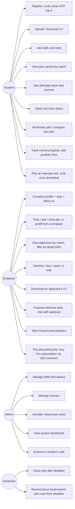

# Database and System Design

## Collections

```mermaid
erDiagram
    USERS ||--o| STUDENT_PROFILES : "userId"
    USERS ||--o| EMPLOYER_PROFILES : "userId"
    USERS ||--o{ JOBS : "employerId"
    JOBS ||--o{ APPLICATIONS : "jobId"
    USERS ||--o{ APPLICATIONS : "studentId"
    USERS ||--o{ NOTIFICATIONS : "userId"
    USERS ||--o| EMAIL_OTPS : "userId"
    SKILLS ||--o{ COURSES : "skillIds[]"
    USERS ||--o{ SAVED_JOBS : "studentId"
    JOBS ||--o{ SAVED_JOBS : "jobId"
    APPLICATIONS ||--o{ INTERVIEWS : "applicationId"
    APPLICATIONS ||--o{ CHAT_MESSAGES : "applicationId"
    USERS ||--o{ JOB_TEMPLATES : "employerId"
    USERS ||--o{ PAYMENTS : "employerId"
    JOBS ||--o| PAYMENTS : "jobId"

    USERS { string id string name string email "unique" string password "BCrypt" string role boolean active boolean emailVerified }
    STUDENT_PROFILES { string userId "unique" string department double cgpa int graduationYear array skills "embedded {skillId, skillName, level, endorsed, endorsedByName, endorsedAt}" string githubUrl string linkedinUrl string websiteUrl array courseProgress "embedded {courseId, courseTitle, status, updatedAt}" string cvOriginalFilename string cvStoredFilename }
    EMAIL_OTPS { string id string userId "unique" string email string otpHash "BCrypt" date expiresAt boolean used int attempts date lastSentAt }
    EMPLOYER_PROFILES { string userId "unique" string companyName string website string location string aboutUs string logoStoredFilename string logoOriginalFilename string subscriptionPlan date subscriptionExpiresAt }
    PAYMENTS { string id string employerId "null for student payments" string studentId "null for employer payments" string payerRoleValue string tranId "unique" string purpose string jobId string plan double amount string currency string status string valId string paymentMethod date createdAt date paidAt boolean effectPending }
    SKILLS { string id string name "unique" string category array aliases }
    JOBS { string id string employerId string companyName string title string type date deadline string status array requiredSkills "embedded {skillId, skillName, requiredLevel, weight, mandatory}" }
    COURSES { string id string title string platform string url int level boolean free array skillIds }
    APPLICATIONS { string id string jobId string studentId string department double cgpa string status double matchPercent boolean eligible }
    NOTIFICATIONS { string id string userId string message boolean read }
    SAVED_JOBS { string id string studentId string jobId "compound unique with studentId" string jobTitle string companyName date savedAt boolean deadlineReminderSent }
    INTERVIEWS { string id string applicationId string jobId string employerId string studentId array proposedSlots string selectedSlot string status }
    JOB_TEMPLATES { string id string employerId string name string title string type string location array requiredSkills }
    CHAT_MESSAGES { string id string applicationId string senderId string senderRole string senderName string text date sentAt }
    QUIZ_QUESTIONS { string id string skillId string question array options int correctIndex string explanation int difficulty }
    QUIZ_ATTEMPTS { string id string studentId string skillId array questionIds array answers string status double scorePercent int levelAchieved date startedAt date expiresAt }
    INTERVIEW_QUESTIONS { string id string skillId string question array keyPoints int difficulty }
    MOCK_INTERVIEW_SESSIONS { string id string studentId array items "embedded {questionId, answer, selfRating, covered, missed}" string status double score }
    JOB_ALERTS { string id string studentId string name string keyword string type string location string skillId int minMatch boolean emailEnabled boolean active date lastCheckedAt int totalJobsSent }
    COMPANY_REVIEWS { string id string employerId string studentId "compound unique with employerId" int rating string title string pros string cons string status string moderationNote }
    PASSWORD_RESET_CODES { string id string userId string codeHash int attempts date expiresAt }
    XP_EVENTS { string id string studentUserId int xp string reason string onceKey date at }
    AUDIT_LOGS { string id date at "TTL 365 days" string actorEmail string action string targetType string targetId boolean success string ipAddress }
```



## Embedded vs. referenced data, and why

MongoDB offers two ways to model a relationship: **embed** the data inside the same document, or **reference** another document by its id.

| Data | Approach | Reason |
|---|---|---|
| A student's skills | **Embedded** (`student_profiles.skills`) | Always needed together with the profile, small in number (at most 40), never queried on their own. One read gives the matcher everything it needs |
| A job's required skills | **Embedded** (`jobs.requiredSkills`) | Every job view needs all of them; matching needs no extra query |
| Skill name | **Copied** (skillName) alongside the skillId reference | Job lists and profiles can be shown without looking up the skills collection each time. When the admin renames a skill, `SkillService` updates every copy |
| Company name inside a job | **Copied** | The job list shows the company without an extra lookup. Updated when the employer profile changes |
| Applications | **Separate collection, referenced** | Can grow large, are queried from both the employer and the student side, and their status changes often |
| Courses ↔ Skills | **Referenced** (`skillIds`) | One course teaches many skills and one skill has many courses: many-to-many |
| User ↔ Profile | **Referenced** (`userId`) | Login only needs the user, not the profile. Profiles have a different shape for each role |
| Signup OTP | **Separate collection, referenced** (`email_otps.userId`) | Its own short lifecycle (expires, gets replaced on resend, is irrelevant once verified) has nothing to do with the rest of the account; keeping it off `User` avoids growing that document with fields that matter for only a few minutes |
| A student's CV / an employer's logo | **Referenced by filename**, file stored outside MongoDB | `student_profiles.cvStoredFilename` / `employer_profiles.logoStoredFilename` point at a file under `CV_UPLOAD_DIR` / `LOGO_UPLOAD_DIR` on local disk; the actual bytes are not written into MongoDB, which keeps documents small and lets the file be streamed straight from disk on download. Both use the exact same UUID-filename / path-traversal-safe pattern - only the logo is served without an authorization check, because it is meant to be public branding |
| Course progress | **Embedded** (`student_profiles.courseProgress`) | Small, always shown together with the profile, never queried on its own - same reasoning as embedded skills |
| Skill endorsement | **Embedded fields on the skill itself** (`student_profiles.skills[].endorsed/endorsedByName/endorsedAt`) | It is a property of one specific skill entry, not a separate fact worth its own collection |
| Portfolio links (GitHub/LinkedIn/website) | **Embedded** (`student_profiles.githubUrl/linkedinUrl/websiteUrl`) | Three optional strings shown only on the profile; no benefit to a separate collection |
| Saved/bookmarked jobs | **Separate collection, referenced** (`saved_jobs`) | Queried independently of the job or the student (its own "My saved jobs" page) and needs its own compound-unique index (`studentId` + `jobId`) and a `deadlineReminderSent` flag the scheduler updates |
| Interviews | **Separate collection, referenced** (`interviews.applicationId`) | A one-to-many relationship with its own lifecycle (`PROPOSED` → `SCHEDULED`/`CANCELLED`) that outlives a single page view and is queried from both the employer and the student side |
| Chat messages | **Separate collection, referenced** (`chat_messages.applicationId`) | Can grow without bound per application and is always paginated/queried on its own, never needed in full alongside the application |
| Job templates | **Separate collection, referenced** (`job_templates.employerId`) | Independent of any one job; an employer manages a list of templates on its own page, unrelated to `jobs` |
| Payments | **Separate collection, referenced** (`payments.employerId`, `payments.jobId`) | Each payment attempt is its own record with its own lifecycle (`PENDING` → `SUCCESS`/`FAILED`/`CANCELLED`) and needs a unique `tranId` lookup when SSLCommerz redirects back; billing history is also queried on its own, independent of jobs |
| Subscription plan/expiry | **Embedded** (`employer_profiles.subscriptionPlan/subscriptionExpiresAt`) | Two small fields read on almost every job-posting decision (`EmployerProfile.isProActive()`); embedding avoids an extra lookup on the hot path |

## Indexes
- `users.email` unique: the same email cannot register twice
- `student_profiles.userId`, `employer_profiles.userId` unique
- `skills.name` unique
- `jobs.employerId`, `jobs.status`: fast lookup of an employer's jobs and of open jobs
- `applications {jobId, studentId}` **compound unique**: a student cannot apply to the same job twice, even with two simultaneous clicks (the database itself blocks the second insert)
- `courses.skillIds`, `notifications.userId`
- `email_otps.userId` unique: one active OTP document per user; a resend overwrites it instead of inserting a second one
- `saved_jobs {studentId, jobId}` **compound unique**: a student cannot bookmark the same job twice
- `interviews.applicationId`, `interviews.studentId`: fast lookup from either side of the interview
- `chat_messages.applicationId`, `job_templates.employerId`: every list on these collections is scoped to one id
- `payments.tranId` unique: SSLCommerz's success/fail/cancel/ipn callbacks look a payment up only by this id
- `payments.employerId`: fast lookup of one employer's billing history

## Request flow (layered architecture)

```
Browser (HTML + JS)
   │  fetch + "Authorization: Bearer <JWT>"
   ▼
JwtAuthenticationFilter  → validates the token, checks the user is active
   ▼
Controller  (@PreAuthorize role checks, @Valid input validation)
   ▼
Service     (business rules: ownership, deadline, status transitions, matching)
   ▼
Repository / MongoTemplate
   ▼
MongoDB
```
On any error, `GlobalExceptionHandler` always returns JSON with the same shape:
```json
{ "timestamp": "...", "status": 400, "error": "Bad Request", "message": "Deadline must be today or a future date.", "path": "/api/jobs" }
```

## Signup flow (email verification)

```
POST /api/auth/register (multipart: "data" JSON part + optional "cv" file part)
   │  1. Validate input; reject if the email already belongs to a verified account
   │  2. Create the User with emailVerified=false (login is refused until this flips to true)
   │  3. If a CV was attached: validate type/size, store it under a generated filename, save the
   │     reference on StudentProfile
   │  4. Generate a 6-digit OTP, BCrypt-hash it into its own EmailOtp document, email it (best effort)
   ▼
"Verify your email" page → POST /api/auth/verify-otp {email, otp}
   │  Checks: an OTP document exists, is not used, is not expired, has not failed too many times,
   │  and the hash matches. Any failure returns a specific, user-friendly message.
   ▼
Success: User.emailVerified = true, a JWT is issued (same response shape as /login)
```
`POST /api/auth/resend-otp` repeats step 4 above (replacing the previous OTP document) but is refused
with `429` if the previous code was sent less than `OTP_RESEND_COOLDOWN_SECONDS` ago.

## Payment flow (SSLCommerz)

```
Employer posts a job past the free quota (JobService.create)
   │  No active Pro subscription → job saved with status=PENDING_PAYMENT (never in public search)
   ▼
Frontend: POST /api/payments/job/{id}/initiate
   │  PaymentService creates a PENDING Payment (own tranId) and calls SSLCommerz's Session API
   │  server-to-server → gets back a GatewayPageURL
   ▼
Browser does a full-page redirect to GatewayPageURL (SSLCommerz-hosted checkout)
   │  Customer pays (or cancels) on SSLCommerz's own page
   ▼
SSLCommerz redirects the browser to /api/payments/sslcommerz/success|fail|cancel
   │  PaymentService looks the Payment up by tranId, then - for a claimed success - calls
   │  SSLCommerz's Order Validation API server-to-server before trusting it at all (the browser
   │  redirect alone proves nothing: it could be replayed or forged)
   │  Validated → Payment.status=SUCCESS, and the effect is applied: the job flips to OPEN, or the
   │  employer's subscriptionExpiresAt is extended (never overwritten, so an early renewal keeps the
   │  remaining time)
   ▼
Redirect to payment-result.html?status=...&purpose=...  (friendly success/failed/cancelled message)
```
SSLCommerz may also call `/api/payments/sslcommerz/ipn` server-to-server for the same transaction, as
a reliability backup for a browser that never made it back. Because both can arrive at the same moment,
`PaymentService.processCallback` does not rely on "read status, then save": the move to SUCCESS is one
atomic conditional update (`status in PENDING/FAILED/CANCELLED`), and the effect is applied by whichever
caller atomically flips `Payment.effectPending` from true to false, so it is applied exactly once. A fail
or cancel callback only moves a still-PENDING payment, so it can never overwrite a SUCCESS.

**Student Pro** uses the same flow with `purpose=STUDENT_PRO`, `studentId` set and `employerId` null; the
effect is `StudentProfile.proExpiresAt = extendFrom(current, now, days)`. `PaymentPurpose.payerRole()`
is the single source of truth for which role may pay for what, and `PaymentRules.inconsistency()` refuses
to confirm or apply a payment whose purpose, payer role and owner id disagree.

## New feature design notes

- **Skill tests:** the question ids for an attempt are chosen and stored when it starts, so the browser
  only ever gets question text and options; scoring happens on submit against the stored ids. A
  verified result is written onto the embedded `StudentSkill` (`verified`, `verifiedLevel`,
  `verifiedScore`, `verifiedAt`), so the profile, matching and analytics read it without a join.
- **Gamification:** XP, `activityDays` and `awardedKeys` live on `StudentProfile`; each award is also an
  `XpEvent`. `onceKey` makes one-off rewards idempotent (e.g. `APPLY:<jobId>` only counts once). The
  rules (levels, streaks, badges, checklist) are pure functions in `GamificationRules` and unit-tested.
- **Job alerts:** `JobAlertScheduler` runs `JobAlertService.runAll()` on a cron; each check only looks at
  jobs whose `publishedAt` falls in the window (lastCheckedAt, start of this check], so a job is sent once.
- **Audit log:** an `@Audited` annotation on service methods + `AuditAspect` (`@AfterReturning` /
  `@AfterThrowing`) records the actor, action, target, client IP and success. Writing is best-effort
  and wrapped in try/catch, so a logging failure never breaks the business action.
- **Password reset:** the 6-digit code is stored only as a hash, expires, and is limited to a few
  attempts. `passwordChangedAt` on `User` lets the JWT filter reject any token issued earlier.

## Security design
- Passwords are stored as BCrypt hashes and never returned in a response (DTOs are used)
- JWT is stateless, and the user is re-loaded from the database on every request, so deactivating a user takes effect immediately
- Nobody can become ADMIN through registration; the admin account comes only from environment variables
- Employers can only view and change their own jobs and applicants (ownership checks in the service layer)
- The frontend HTML-escapes all user data (XSS protection) and only opens course links that start with `http(s)`
- CSRF protection is disabled because no cookies are used; the token is sent in a header
- A new account cannot log in until its signup OTP is verified (`AuthService.login` checks `emailVerified`); the OTP itself is BCrypt-hashed, expires, and is invalidated after use or too many wrong attempts
- Uploaded CVs are never trusted by their original filename: `FileStorageService` generates a random
  name for every file on disk, which is what rules out path traversal and one user overwriting
  another's file. Downloading one goes through `CvService`, which allows only the student themselves,
  an admin, or an employer the student actually applied to - never employers in general
- Employer logos reuse that exact pattern (`ImageStorageService` mirrors `FileStorageService`: UUID
  filenames, an allow-list of image types, strict path checks on lookup); unlike the CV, the logo is
  intentionally served to anyone (`SecurityConfig` permits `GET /api/companies/**`), since it is public
  branding, not private data
- A student cannot endorse their own skill (checked in `StudentService.setEndorsement`); an admin can
  endorse anyone's. Interview and chat authorization reuse `JobService.checkOwner` on the employer side
  and a direct `studentId` match on the student side, the same ownership-check shape used everywhere else
- Chat only opens once an application is `SHORTLISTED` or `HIRED` (checked in `ChatService`), matching
  the feature as requested ("chat between employer and shortlisted applicant")
- Deleting a job cascades: its applications, saved-job bookmarks, interviews and chat messages are all
  removed too (`JobService.delete`), so nothing is left pointing at a job that no longer exists
- The four `/api/payments/sslcommerz/**` callback endpoints are `permitAll()` (SSLCommerz calls them
  directly, with no JWT) - but they never move money or open a job on their own say: a claimed success
  is re-confirmed server-to-server via SSLCommerz's own Order Validation API first, and applying the
  effect is idempotent so a repeated or forged callback can only no-op, never double-apply

## Use cases


